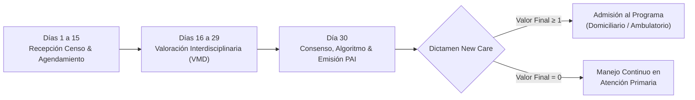

# MANUAL DE USUARIO Y GUÍA METODOLÓGICA OFICIAL
## Herramienta de Valoración Multidimensional (VMD) • Programa New Care
**Optimus Health IPS & Inngeniar Health Suite**  
*En alianza metodológica con Fundación NewHealth*  
*Modelo de Gestión y Cuidados para Pacientes con Insuficiencias Orgánicas Crónicas Complejas (IOCC)*

---

## 1. PRESENTACIÓN GENERAL Y OBJETIVOS

La presente herramienta ha sido diseñada para estandarizar, sistematizar y automatizar el proceso de **Valoración Multidimensional (VMD)** interdisciplinaria y toma de decisiones clínicas para el ingreso de pacientes al **Programa New Care**.

### Canales de Acceso Oficiales
1. **Acceso Centralizado desde Inngeniar Hub:**  
   [https://inngeniar-hub.vercel.app](https://inngeniar-hub.vercel.app) $\rightarrow$ Tarjeta *Optimus Health IPS* $\rightarrow$ **`🚀 Abrir WebApp VMD`**.
2. **Acceso Directo WebApp en Producción:**  
   [https://optimus-newcare-vmd.vercel.app](https://optimus-newcare-vmd.vercel.app)  
   *(Compatible con computadores de escritorio, portátiles, tablets Android/iPad y smartphones sin necesidad de instalar software local).*
3. **Herramienta Local de Contingencia (Microsoft Excel):**  
   Archivo `Herramienta_VMD_NewCare_OptimusHealth.xlsx` con fórmulas automatizadas y consolidado de 51 columnas para operación desconectada.

---

## 2. FLUJO DE ATENCIÓN Y REGLA NORMATIVA DE LOS 30 DÍAS

De acuerdo con los lineamientos de acreditación de la Fundación NewHealth:

* **Días 1 a 15 (Recepción y Agendamiento):** La EPS o red remitente envía el censo de pacientes candidatos con IOCC. El prestador agenda la cita de valoración interdisciplinaria.
* **Días 16 a 29 (Valoración Conjunta en Terreno / Consulta):** El equipo de salud (Médico, Enfermera y Trabajadora Social) aplica las escalas clínicas de severidad, funcionalidad, cognición, nutrición y riesgo sociofamiliar.
* **Día 30 (Consenso Clínico y Formalización del PAI):** Ejecución del algoritmo New Care, consenso de complejidad, asignación de modalidad asistencial y emisión del dictamen formal para presentación ante la Junta de Cronicidad de la EPS.
* **Cadencia de Reevaluación de Seguimiento:**
  * **Alta Complejidad:** Reevaluación multidimensional cada 6 meses.
  * **Media Complejidad:** Reevaluación multidimensional cada 12 meses.
  * **Extraordinaria:** Tras egreso hospitalario por descompensación aguda.

---

## 3. ROLES INTERDISCIPLINARIOS Y SELLOS DE AUDITORÍA

La herramienta implementa el principio de **corresponsabilidad clínica** mediante sellos digitales independientes por profesión:

| Perfil Profesional | Responsabilidad Primaria en VMD | Escalas y Calculadoras a Cargo | Sello de Auditoría |
| :--- | :--- | :--- | :---: |
| 🩺 **Médico Internista / Geriatra / General** | Severidad de IOCC, revisión diagnóstica, suite de riesgo clínico y supervisión del PAI. | NYHA (Cardíaca), GOLD (EPOC), Child-Pugh (Cirrosis), ERC (Renal), CKD-EPI 2021, MELD-Na, BODEx, LACE. | `Sello Médico` (Nombre, Registro Médico, Fecha) |
| 👩‍⚕️ **Enfermera(o) de Práctica Avanzada (EPA)** | Valoración Funcional, Estado Nutricional, Detección de Fragilidad y Riesgo Cutáneo/Caídas. | Índice de Barthel (ABVD), Lawton & Brody (AIVD), Pfeiffer (Cognición), MNA-SF (Nutrición), Downton (Caídas), Braden (UPP). | `Sello Enfermería` (Nombre, Tarjeta Prof., Fecha) |
| 🤝 **Trabajador(a) Social** | Valoración Sociofamiliar, Sobrecarga del Cuidador, Genograma y Red de Apoyo. | Escala de Gijón (Sociofamiliar), Escala de Zarit (Sobrecarga Cuidador), Mapa concéntrico de Red de Cuidados. | `Sello Trabajo Social` (Nombre, Registro TS, Fecha) |
| ⚖️ **Coordinador / Junta de Cronicidad** | Consolidación de dimensiones, aplicación del algoritmo, dictamen de admisión y firma de PAI. | Algoritmo New Care ($T, Z, AF, AL, AR$), Asignación de Ámbito (Domiciliario / Ambulatorio) y Cadencia de Visitas. | `Sello Coordinación` (Dictamen Oficial) |

---

## 4. BASE DE DATOS EN LA NUBE Y SINCRONIZACIÓN (SUPABASE)

La WebApp está conectada en tiempo real a una base de datos relacional **PostgreSQL** alojada en **Supabase** (`newcare-vmd`), con cifrado TLS/HTTPS en tránsito y en reposo:

* **Sincronización Multiusuario en Vivo:** Cuando la enfermera diligencia Barthel o Pfeiffer en una tablet durante una visita domiciliaria, el médico internista ve el puntaje reflejado de inmediato en su pantalla en la sede principal sin recargar la página.
* **Indicador de Conexión en el Encabezado:**
  * 🟢 **`Supabase Nube Activa`:** Conexión en vivo con guardado continuo.
  * 🔵 **`Modo Local (Offline)`:** Modo de contingencia sin conexión; los datos se guardan en el navegador y se sincronizan apenas se restablece internet.
* **Credenciales Integradas:** La aplicación incluye la URL institucional y la *Publishable Key* por defecto, garantizando que cualquier usuario que ingrese desde el Hub quede conectado en verde desde el primer segundo.

---

## 5. GESTIÓN DEL EQUIPO DE SALUD

En la pestaña **"Directorio Equipo de Salud"**:
1. **Consultar Personal Acreditado:** Tabla activa con nombres, roles, registros médicos o de enfermería, especialidad y contactos.
2. **Registrar Nuevos Profesionales:** Clic en **`+ Registrar Nuevo Profesional`** para matricular médicos, enfermeras, trabajadoras sociales, nutricionistas o gestores de caso.
3. **Selección del Evaluador Activo:** En la barra superior, el selector desplegable permite alternar en 1 segundo quién está firmando la valoración, aplicando un fondo oscuro de alto contraste y letras blancas nítidas.

---

## 6. GESTIÓN DE PACIENTES Y CARGA MASIVA (EXCEL / CSV)

El sistema soporta tanto la creación individual como el **enrolamiento masivo de censos poblacionales** entregados por las aseguradoras.

### El Flujo en Dos Etapas (Recomendado):

#### Etapa 1: Carga Masiva Administrativa (Columnas A hasta H)
El personal de admisiones o gestión del riesgo descarga la plantilla haciendo clic en **`📄 Plantilla Excel`** y diligencia únicamente las 8 columnas obligatorias:
* **Col A:** `Documento` (Cédula del paciente - Clave primaria).
* **Col B:** `Nombre_Completo` (Nombres y apellidos).
* **Col C:** `Edad` (Años cumplidos).
* **Col D:** `Sexo` (`M` o `F`).
* **Col E:** `EPS` (Asegurador).
* **Col F:** `Telefono` (Contacto).
* **Col G:** `Direccion` (Residencia).
* **Col H:** `Criterio_Primario` (`IC`, `EPOC`, `CIRROSIS` o `ERC`).

> **Las columnas de la I a la S (escalas de valoración) se dejan vacías.**  
> Al subir el archivo con el botón verde **`📥 Importar Excel / CSV`**, el sistema da de alta a todos los pacientes, los sube a Supabase y les asigna el distintivo **`🟡 Por Valorar`** con estado **`Pendiente de Valoración VMD`**.

#### Etapa 2: Valoración Clínica en Terreno (En la WebApp)
El equipo asistencial abre al paciente desde el padrón y realiza la valoración en la app:
* **Médico:** Clasifica severidad clínica y calcula riesgo.
* **Enfermera:** Aplica Barthel, Lawton, Pfeiffer y MNA-SF con los cuestionarios asistidos.
* **Trabajo Social:** Aplica Gijón y Zarit.
* Al presionar **"Guardar Valoración VMD"**, el estado cambia automáticamente a evaluado y se genera el PAI.

---

## 7. EL ALGORITMO MATEMÁTICO NEW CARE

La estratificación de complejidad opera bajo la siguiente formulación oficial:

$$\text{Valor Final} = \begin{cases} \min(2, T + 1) & \text{si } Z = 2 \lor AF = 2 \lor AL = 2 \lor AR = 2 \\ T & \text{en caso contrario} \end{cases}$$

### Desglose de Dimensiones:
1. **$T$ (Severidad Orgánica - Eje Preponderante):** Base $= \max(\text{NYHA}, \text{GOLD}, \text{Child-Pugh}, \text{ERC})$.
   * $0 =$ Baja severidad (NYHA I, GOLD A, Child-Pugh A, ERC G1-G2).
   * $1 =$ Severidad moderada (NYHA II, GOLD B, Child-Pugh B, ERC G3a-G3b).
   * $2 =$ Severidad alta (NYHA III-IV, GOLD C-D, Child-Pugh C, ERC G4-G5).
2. **$Z$ (Funcionalidad):** $\max(\text{Barthel}, \text{Lawton \& Brody})$. $Z=2$ si Barthel $\le 60$ o Lawton $\le 3$.
3. **$AF$ (Cognitivo):** Test de Pfeiffer. $AF=2$ si presenta $\ge 5$ errores (deterioro moderado a severo).
4. **$AL$ (Nutricional):** MNA-SF. $AL=2$ si puntaje $<8$ puntos (malnutrición establecida).
5. **$AR$ (Social):** $\max(\text{Gijón}, \text{Zarit})$. $AR=2$ si Gijón $\ge 15$ puntos o Zarit $\ge 56$ (sobrecarga intensa del cuidador).

### Criterio de Ingreso al Programa New Care:
* **Valor Final = 2 (Alta Complejidad):** **INGRESA AL PROGRAMA**.  
  * *Si Barthel $\le 60$ o $Z=2$:* **Modalidad Domiciliaria** (visita presencial médica, enfermería y TS mensual + llamada quincenal).  
  * *Si conserva funcionalidad:* **Modalidad Ambulatoria** (consulta médica trimestral + llamada mensual).
* **Valor Final = 1 (Media Complejidad):** **INGRESA AL PROGRAMA**.  
  * **Modalidad Ambulatoria** (consulta médica cada 4-6 meses + llamada cada 2-3 meses).
* **Valor Final = 0 (Baja Complejidad):** **NO CUMPLE CRITERIOS DE INGRESO**.  
  * Manejo preventivo continuo en Atención Primaria con control anual.

---

## 8. SUITE DE RIESGO CLÍNICO Y CALCULADORAS MÉDICAS

En la pestaña **"Suite de Riesgo Clínico"**:
* **CKD-EPI 2021 (Función Renal):** TFG calculada automáticamente sin sesgo racial a partir de creatinina, edad y sexo. Alerta de estadio ERC.
* **MELD / MELD-Na (Cirrosis Hepática):** Mortalidad a 3 meses a partir de Bilirrubina, Creatinina, INR y Sodio.
* **Índice BODEx (EPOC):** Integración de IMC, FEV1%, escala de disnea mMRC y exacerbaciones anuales.
* **Escala de Downton (Riesgo de Caídas):** Puntaje $>2$ activa protocolo de caídas y adaptaciones en el hogar.
* **Escala de Braden (Lesiones por Presión):** Puntaje $\le 12$ activa medidas preventivas y colchón antiescaras.
* **Índice LACE (Reingreso a 30 Días):** Cuantifica riesgo de hospitalización no programada pos-alta.

---

## 9. RED DE CUIDADOS Y GENOGRAMA FAMILIAR

En la pestaña **"Red de Cuidados"**:
* **Mapa Concéntrico Interactivo:** Cuantifica la red de apoyo en 3 niveles:
  1. *Círculo Interno:* Familia conviviente y cuidadores primarios (hijos, cónyuge, nietos).
  2. *Círculo Externo:* Familia no conviviente, vecinos, amigos cercanos, farmacia de barrio.
  3. *Círculo Comunitario:* Centros de día, voluntariados, parroquias, grupos de apoyo.
* **Identificación del Cuidador Principal:** Registra nombres, edad, parentesco y horas de cuidado diario para cruzar con el Índice de Zarit y prevenir el síndrome del cuidador quemado (*burnout*).

---

## 10. EMISIÓN DEL PLAN DE ATENCIÓN INDIVIDUALIZADO (PAI)

En la pestaña **"Plan de Atención (PAI) & Dictamen"**:
1. **Generación Automática del Dictamen:** Resume el puntaje de cada dimensión, la clasificación de complejidad y la modalidad sugerida (Domiciliaria o Ambulatoria).
2. **Líneas de Intervención Personalizadas:** Redacción estructurada de metas en 4 ejes:
   * *Sanitarias / Médicas:* Control de síntomas, optimización farmacológica y metas de tensión/glucemia.
   * *Nutricionales:* Dieta terapéutica, requerimientos proteicos y suplementación.
   * *Psicológicas / Cognitivas:* Estimulación cognitiva y apoyo emocional familiar.
   * *Sociales:* Articulación con redes comunitarias, subsidios y respiro al cuidador.
3. **Formato Oficial Listo para Impresión / PDF:**  
   Al presionar el botón **`🖨️ Imprimir Dictamen / PAI`**, se activa la hoja de estilo médica oficial con encabezados institucionales, tablas de puntajes y espacios para las firmas del equipo tratante para archivar en la Historia Clínica.

---

## 11. COPIAS DE SEGURIDAD Y PLAN DE CONTINGENCIA

La herramienta cuenta con una triple salvaguarda de datos:

1. **`Backup JSON` y `Restaurar JSON`:** Permite descargar o restaurar en 2 segundos una fotografía idéntica de la base de datos completa con todos sus cuestionarios y micro-datos.
2. **`Exportar Excel (51 cols)`:** Genera el archivo plano oficial de 51 columnas reglamentarias de New Care para auditorías de calidad o presentación de informes a la gerencia de la EPS.
3. **Libro Autónomo en Excel (`Herramienta_VMD_NewCare_OptimusHealth.xlsx`):** Cuaderno con fórmulas y calculadoras nativas que opera de forma vitalicia y sin necesidad de internet en cualquier equipo con Microsoft Office.

---
*Manual elaborado por Inngeniar Health Suite para Optimus Health IPS.*  
*Versión 1.0 — Noviembre 2026.*
